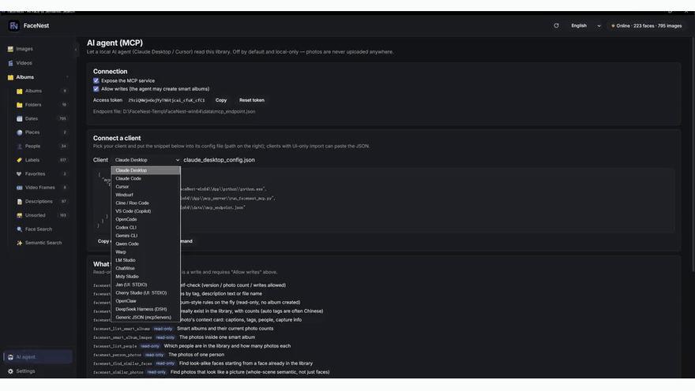

<div align="center">


# facenest-mcp

**Let Claude / Cursor / Codex / DSH / OpenCode read the photo library on your own computer.**

28 tools · zero dependencies · photos never leave your machine · writes are off by default

<p>
<a href="https://www.python.org/"></a>
<a href="LICENSE"></a>
<a href="https://github.com/eclgo/facenest-mcp/actions/workflows/test.yml"></a>
</p>
<p>
<a href="docs/AGENT_GUIDE.md"></a>
<a href="#install-in-30-seconds"></a>
</p>

[facenest.net](https://facenest.net) · [Free download](https://facenest.net/download) · [简体中文](README.zh-CN.md)

</div>

> This is the [MCP](https://modelcontextprotocol.io) adapter for **[FaceNest](https://facenest.net)** —
> a local-first photo manager: faces, tags, AI captions and the semantic index all run on your own machine.
> Only the **adapter** is open source (MIT); the app itself is closed source. **Photos, videos and the index never leave your computer.**



<p align="center"><sub>One 46-second local recording: the assistant's replies play at real speed (not accelerated), while tool calls and indexing waits are trimmed. Pick candidates by sharpness inside an album, lay them out as a numbered contact sheet, the user confirms by number, the album gets built; then pick video frames by smiling and collect them as photos. Everything on the local machine — the assistant never acts on its own.</sub></p>

---

## Why it is worth a try

**1. It reads answers that are already computed — it does not look at your pictures.**
The expensive part of your library already exists: AI captions, auto tags, face clusters, capture times, GPS.
Without MCP an agent can only "look at pictures" (slow, expensive, it guesses); with it the agent gets
**material cards carrying an `image_id`**.

**2. There is a "show me first, I say yes, then you act" loop.**
`pick_best_photos` picks candidates → `make_contact_sheet` lays them out as a **numbered preview wall** →
you reply "keep #2 and #5" → only then is an album created or files copied.
That is the biggest difference from every other photo MCP: **the assistant does not dump 200 pictures into your project folder.**

**3. Writes are the minority, and the irreversible ones are not offered.**
Of the 28 tools, **22 are read-only and 6 write**. Writing needs a separate switch in the app;
**no tool can delete or move your photo files** — the only delete removes an album **definition**, the photos stay where they are,
and the reply contains a snapshot you can rebuild the album from.

**4. Zero dependencies, auditable protocol.**
Python 3.9+ standard library only (stdio JSON-RPC written by hand, no SDK). The whole protocol is two files you can read end to end.
Not for style points — so it runs on a machine that only has Python installed.

---

## Install in 30 seconds

**Prerequisite: install FaceNest first (the free tier is enough: 500 photos in the library, 200 semantic queries).**
👉 [facenest.net/download](https://facenest.net/download) · Windows today; the current macOS status is stated on the website.

```bash
# 1) In the app: Settings → AI agent (MCP) → turn on "Expose the MCP service", copy the endpoint file path
# 2) Install the adapter
git clone https://github.com/eclgo/facenest-mcp.git
cd facenest-mcp
python -m pip install -e .

# 3) Self-test (no client needed)
facenest-mcp --selftest
# → OK  http://127.0.0.1:<port>  api=1  images=1234  write_allowed=false
```

`OK` means it is connected. Next, paste the **absolute** path of the endpoint file into your client config ([below](#connect-a-client)).

The full install page — the `uvx` one-liner, the editable install, the four paste-ready client
configs and the verification commands — is **[docs/QUICKSTART.md](docs/QUICKSTART.md)**.

> 🔒 `mcp_endpoint.json` holds a plaintext token — treat it like a password. It is in `.gitignore`.
> ⚠️ The port is chosen at runtime by the app; `1992` in an example file is just an example — **trust `--selftest`**.
> ⚠️ Use an **absolute** path in client configs: auto-detection depends on the process working directory and is unreliable under GUI clients.

<details>
<summary>Not on PyPI yet? Two alternatives</summary>

- **Works today, no PyPI needed**: `uvx --from git+https://github.com/eclgo/facenest-mcp facenest-mcp --selftest`
  — `uv`/`uvx` pulls it straight from GitHub; no `git clone`, no `pip install -e .`.
- Or use the editable install above, and put the clone on `PYTHONPATH`.
- Publishing on PyPI is on the roadmap: once published, configs shrink to `uvx facenest-mcp`.
</details>

---

## Five things people actually use

> Every line below can be pasted straight into your assistant. The tool chain is folded away for integrators.
> Counts and seconds depend on your own library — they are not benchmarks.

### ① Find a person in your videos, keep the frames where they smile

> **You:** "Find every clip where Xiaoyu appears in my videos, and save the 3 frames where she smiles best as photos."

**The assistant:** lists videos → locates the timestamps where that person appears → picks 3 frames smiling-first → collects them in batch
**You get:** 3 new photos (you can then build an album from them); the video is not touched, byte for byte
**Limits:** batch collection is **≤10 frames per call, 40 frames per session** (counted per frame); the single-frame tool is also 40 per session; time accuracy is ± one frame interval (default 2 s); a face too small to measure returns `smile:null`, which is not "not smiling"

<details><summary>Tool chain</summary>

`facenest_list_videos` → `facenest_list_people` → `facenest_find_person_in_videos` → `facenest_pick_best_video_frames {cluster_id, video_id?, preset:"face", prefer_smiling:true, top:3}` → `facenest_collect_video_frames {frame_ids:[…]}`

</details>

### ② Pick PPT material from your library, and deliver only after you confirm

> **You:** "From my asset folders, find large landscape 16:9 shots that could be an autumn-campaign cover, give me a numbered preview, then copy my picks into `D:\Deck\assets`."

**The assistant:** semantic search / tag filters → ranks by sharpness, keeps 16:9 → lays out a numbered preview wall → you say "keep #2 and #7" → it copies the **original bytes** into your folder
**You get:** files sitting in your project folder, names following `{index:02d}-{name}{ext}`; a HEIC stays a HEIC, not the internal preview
**Limits:** ≤200 files per call, ≤2000 per session; the target folder must **already exist** and cannot be the library or the app's own folders; no overwrite by default (` (2)` appended); sharpness is a relative ranking inside the batch — glance at the thumbnails before you ship

<details><summary>Tool chain</summary>

`facenest_semantic_search` or `facenest_query_photos` → `facenest_pick_best_photos {scope:{kind:"image_ids", image_ids:[…]}, mode:"sharpness", aspect:"16:9", top:8}` → `facenest_make_contact_sheet {image_ids}` → `facenest_copy_photos {target_dir, rename_pattern}`

</details>

### ③ Turn 10 picks from a trip album into a shareable album

> **You:** "From the 'Okinawa 2025' album, pick the 10 best smiles and build a smart album called 'Okinawa picks'."

**The assistant:** reads the album → measures each face's smile → takes the top 10 → creates the album from those 10 ids
**You get:** a 10-photo album you can see right in the app, ready to share or export
**Limits:** faces under 64 px are not scored (`smile:null`); the album stores the **fixed ids** — later changes to the source album do not follow automatically

<details><summary>Tool chain</summary>

`facenest_list_albums` → `facenest_pick_best_photos {scope:{kind:"album", album_id:…}, mode:"smile", top:10}` → `facenest_create_smart_album {name:"Okinawa picks", rules:[{type:"photos", op:"in", ids:[…]}]}`

</details>

### ④ Collect single-person reference shots for AI video / ComfyUI

> **You:** "In People, find A-Ming's front-facing solo photos, pick the 5 sharpest, copy them to `D:\ComfyUI\input\refs`."

**The assistant:** finds the person → takes his photos → ranks **exactly those ids** by sharpness → previews for confirmation → copies them over
**You get:** a `refs` folder of originals (not compressed previews), ready to feed a workflow
**Limits:** sharpness mode does not accept a whole person as the scope — you must take ids first, which is deliberate: no scanning tens of thousands; originals are read and written locally, never uploaded

<details><summary>Tool chain</summary>

`facenest_list_people` → `facenest_person_photos` → `facenest_pick_best_photos {scope:{kind:"image_ids", image_ids:[…]}, mode:"sharpness", top:5}` → `facenest_make_contact_sheet` → `facenest_copy_photos {target_dir:"D:\\ComfyUI\\input\\refs"}`

</details>

### ⑤ Split an AI-generated folder into "with people" and "everything else"

> **You:** "Split the AI-generated images in this folder into two albums: ones with a person, ones with none."

**The assistant:** builds two rules on face count: `person_count ≥ 1` and `person_count = 0`
**You get:** two smart albums; new files in that folder land in the right album automatically (provided the folder is watched by auto-import)
**Why this way:** `origin` only has `photo` / `video_frame` — **there is no "AI" value**; AI output usually has no EXIF (`shot_at` is `null`), but `taken_at` falls back to the file time, so **date rules still work**. Classification goes by "is there a face", not by guessing the source

<details><summary>Tool chain</summary>

Two `facenest_query_photos` calls: first `{rules:[{type:"person_count",op:"gte",n:1}]}` → `facenest_create_smart_album {name:"With people", rules:[…]}`; second `{rules:[{type:"person_count",op:"eq",n:0}]}` → `facenest_create_smart_album {name:"The rest", rules:[…]}`

</details>

> Want more? [`docs/TESTING.md`](docs/TESTING.md) holds 73 numbered requests (with the expected tool chain and the failure signals to judge); these showcase demos, with their prompts, chains and limits, are in [`docs/DEMOS.md`](docs/DEMOS.md). Chinese mirrors: [TESTING.zh-CN.md](docs/TESTING.zh-CN.md) · [DEMOS.zh-CN.md](docs/DEMOS.zh-CN.md).

---

## How this differs from "let the AI look at the pictures"

| | Feeding the assistant screenshots | This adapter |
|---|---|---|
| Input | A few pictures you paste by hand | **Existing metadata** of the whole library |
| Locating | "looks like a beach" | `image_id`, reusable by every other tool |
| Cost | Vision tokens per picture | Text cards: cheap and repeatable |
| Combining conditions | The model has to judge on its own | A closed rule grammar (date / place / person / face count / camera / lens / tag / caption) |
| Delivery | You screenshot and save elsewhere | Build albums, copy originals, collect video frames |
| Privacy | Uploaded to a model vendor | Only `127.0.0.1` |

---

## The 28 tools

Every parameter, the required ones, and the per-tool quotas are in **[docs/TOOLS.md](docs/TOOLS.md)** — a generated page (built from the tool schema, kept word-for-word with the code; a stale page fails the suite). The table below is the human-speed view by group.

**Only going to use one line? Remember this one: ask `facenest_ping` first.** It returns `ok / api_version / images / write_allowed`, and its failure paths are the clearest in the project.

| Group | Count | What it does |
|---|---|---|
| Connection | 1 | Reachability, API version, write permission |
| Finding | 5 | Tag / caption / file name, natural language, one material card, read-only rule query |
| People | 4 | Who is in the library, one person's photos, similar faces, find photos that look like a picture |
| Albums | 6 | List, read contents, create / update / delete **definitions** |
| Places | 2 | Country → state → city (photos with GPS only) |
| Video | 6 | Who appears at what second, frame timeline, best frames, collect frames |
| Picking & delivery | 3 | Top-N by smile/sharpness, numbered preview wall, copy originals |
| Tidying | 1 | Duplicate / burst groups (deletes nothing) |

<details>
<summary><b>Expand all 28 tools</b> (permission / one-line description)</summary>

| Tool | Permission | Group | Description |
|---|---|---|---|
| `facenest_ping` | read | Connection | Reachability, API version, photo count, whether writes are allowed |
| `facenest_search` | read | Finding | Search by tag / caption text / file name (**no date, no place**) |
| `facenest_query_photos` | read | Finding | Runs the smart-album rule set once, read-only, nothing saved |
| `facenest_semantic_search` | read | Finding | Natural-language search ("a dog on a beach"), spends semantic queries |
| `facenest_image_context` | read | Finding | One photo's card: captions, tags, people, EXIF, every date field |
| `facenest_list_tags` | read | Finding | Tags that really exist in the library, with counts (auto tags are often Chinese) |
| `facenest_similar_photos` | read | People | Image-to-image: `image_id` or a local `image_path`, whole-picture similarity |
| `facenest_list_people` | read | People | People in the library and their photo counts |
| `facenest_person_photos` | read | People | One person's photos (an id list you can feed to the pickers) |
| `facenest_find_similar_faces` | read | People | Similar faces; the reference can be a face in the library or a local image (HEIC included) |
| `facenest_list_albums` | read | Albums | Normal albums (incl. collected video frames) with counts, offset paging |
| `facenest_list_smart_albums` | read | Albums | Smart albums and their current counts |
| `facenest_smart_album_images` | read | Albums | Photos inside one smart album |
| `facenest_create_smart_album` | **write** | Albums | Create an album from rules (max 30 rules) |
| `facenest_update_smart_album` | **write** | Albums | Change an album **in place** (name/rules/sort/group), `smart_id` stays |
| `facenest_delete_smart_album` | **write** | Albums | Delete an album **definition** (photos untouched; ≤20/session; returns a rebuild snapshot) |
| `facenest_list_places` | read | Places | Country → state → city tree with counts |
| `facenest_photos_in_place` | read | Places | Photos of one place node |
| `facenest_list_videos` | read | Video | Videos and how many frame faces are indexed |
| `facenest_find_person_in_videos` | read | Video | Which videos a person appears in, at what second |
| `facenest_list_video_frames` | read | Video | A video's frame timeline (timestamps + faces), writes nothing |
| `facenest_pick_best_video_frames` | read | Video | Best N frames by mode (portrait / largest face / sharpest; smiling first), plus the other modes as alternatives |
| `facenest_collect_video_frame` | **write** | Video | Collect one frame (≤40/session; an out-of-range timestamp is an error; prefer the batch tool) |
| `facenest_collect_video_frames` | **write** | Video | Collect ≤10 frames in one call (40 frames per session, counted per frame) |
| `facenest_pick_best_photos` | read | Picking | Top-N by **smile** or **sharpness** (album / folder / person / favorites / tag / date / smart album / ids; resumable) |
| `facenest_make_contact_sheet` | read | Picking | Numbered thumbnail wall of 1–60 photos (URL valid 1 hour), so the user can answer "keep #2 and #5" |
| `facenest_copy_photos` | **write** | Picking | Copy **original bytes** into a folder the user names (≤200/call, ≤2000/session, no overwrite by default) |
| `facenest_find_duplicates` | read | Tidying | Duplicate / burst groups with reclaimable bytes, **deletes nothing** |

</details>

Rules are structured JSON, not prose. The full closed value set (the `op`s of person / tag / date / place, `source`, date formats,
`match_mode` / `sort` / `group_by`) is in **[docs/AGENT_GUIDE.md §3](docs/AGENT_GUIDE.md)**; anything outside it comes back as `ERR_SMART_*`.

```json
{"type":"tag","op":"has","name":"beach"}
{"type":"date","op":"between","from":"2025-06-01","to":"2025-08-31"}
{"type":"person","op":"is","cluster_id":12}
{"type":"place","op":"is","city":"Mong Kok"}
{"type":"person_count","op":"eq","n":0}
{"type":"photos","op":"in","ids":["7cd7…","88ab…"]}
```

> Full parameters, return shapes and quotas: [`docs/TOOLS.md`](docs/TOOLS.md) (generated from the tool schema) and [`docs/AGENT_GUIDE.md`](docs/AGENT_GUIDE.md) §3–§4.
> The tool list is generated by `facenest-mcp --list-tools` (`scripts/_dump_tools.py` → `docs/_generated/_tools.txt`), and a test guards it: drop a tool or an error code and the suite goes red.

---

## Safety boundaries

- **`127.0.0.1` only** — no telemetry, no cloud relay, no account.
- The adapter **never opens your database or photo files**. The only two file-touching operations run in the app:
  the `image_path` reference image (read once, not imported) and `copy_photos` (copies original bytes).
- Flip the switch off in the app → every call **fails with 403 immediately**; reset the token → the next call **401**.
- Write tools are authorised separately and accept **structured rules only**; a caption is never passed through as a parameter.
- Text extracted from images is labelled `untrusted_text`, never treated as an instruction.
- Every call is written to the app's local audit log, visible in the app.

---

## Connect a client

Any client that speaks **stdio MCP** works. Only two things matter: the command
`python -m facenest_mcp` and the argument `--endpoint <absolute path>`.

**The four paste-ready blocks (Claude Desktop / Cursor / OpenCode / Codex CLI) are in
[docs/QUICKSTART.md](docs/QUICKSTART.md)** — config examples are maintained on that page only,
so the same instructions do not live in two places.

> On Windows, write JSON / TOML paths as `\\`. Without `--endpoint` the adapter tries the usual locations; `FACENEST_ENDPOINT` works too.
> System prompt for agents: `facenest-mcp --agent-prompt` (paste it into Cursor Rules / a Claude Project as well).

---

## Troubleshooting

| Symptom | Do this first |
|---|---|
| `--selftest` exit code **2** | Endpoint file not found → re-open MCP in the app, or pass `--endpoint` with an absolute path |
| Exit code **3** | Nothing is listening on that port → the app is closed, or the switch is off |
| Exit code **1** | Reached and refused → the token was reset, or the switch was turned off |

Everything else — the write switch, an assistant inventing ids, which reference the app uses
when several are given at once, the port changing after an app restart, a search that comes back
empty — is in **[docs/TROUBLESHOOTING.md](docs/TROUBLESHOOTING.md)**. Troubleshooting detail is
maintained on that page only, not here.

Every error reads the same way: `ERR_XXX (HTTP n): meaning / Do next: … / Retry: YES|NO`.
All 36 error codes in full, with the "what to do / retry" column: [docs/AGENT_GUIDE.md §5](docs/AGENT_GUIDE.md).

---

## For AI agents and integrators

If you are writing an agent or an integration layer, skip the README and read this:
**[docs/AGENT_GUIDE.md](docs/AGENT_GUIDE.md)** — return fields, the closed rule-value table, the error codes
(what to do / whether to retry), and a copy-paste system prompt.
For the shape of the whole thing (client ↔ adapter ↔ app), where each number's single source
lives, and which page owns which fact: **[docs/ARCHITECTURE.md](docs/ARCHITECTURE.md)**.

---

## Development

```bash
python -m unittest discover -s tests -v        # unit tests: protocol / error text / doc gates, no app needed
python tests/e2e_stdio.py <mcp_endpoint.json>  # end-to-end, against the sandbox fixtures
facenest-mcp --list-tools                      # prints the JSON schema of the 28 tools
facenest-mcp --call facenest_ping              # call once without a client
```

`tests/e2e_stdio.py` assumes fixture data (`image_id=m1`, tag `beach` matching 1 photo). Running it against a **real library**
will disagree in expected ways — that does not mean the adapter is broken.

**Doc gates**: `tests/test_docs.py` checks that the README lists every tool, that AGENT_GUIDE covers every error code,
that both guides carry the system prompt verbatim, and that the tool and scenario counts quoted in the README equal the
real numbers in the code. Documentation drift is a **failing test** here, not a "we'll fix it later".

CI (GitHub Actions — continuous integration: every push runs this suite) is configured in [`.github/workflows/test.yml`](.github/workflows/test.yml).

---

## What is open source

| | |
|---|---|
| ✅ Open source (MIT) | This adapter: protocol implementation, tool wrappers, error contract, documentation |
| ❌ Not open source | The FaceNest app itself, its models, index and database formats |
| 📄 License | [MIT](LICENSE) |
| 🚫 Not in this repo | App code, models, any user data or photos |

---

<div align="center">

**If this adapter saved you some time, a ⭐ helps more people on Claude / Cursor find it.**
It is also a signal for us: local-first + an auditable protocol is a road worth keeping.

[Website](https://facenest.net) · [Download](https://facenest.net/download) · [Quick start](docs/QUICKSTART.md) · [Docs](docs/AGENT_GUIDE.md) · [Architecture](docs/ARCHITECTURE.md) · [Tool reference](docs/TOOLS.md) · [Troubleshooting](docs/TROUBLESHOOTING.md) · [Changelog](CHANGELOG.md) · [Issues](https://github.com/eclgo/facenest-mcp/issues) · [Contributing](CONTRIBUTING.md) · [Security](SECURITY.md)

</div>
