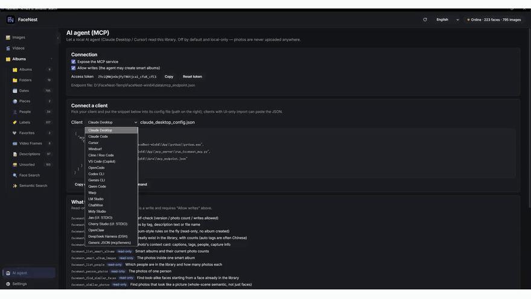

<div align="center">


# facenest-mcp

**让 Claude / Cursor / Codex / DSH / OpenCode 直接读你自己电脑上的照片库。**

28 个工具 · 零依赖 · 照片不出本机 · 写入默认关闭

<p>
<a href="https://www.python.org/"></a>
<a href="LICENSE"></a>
<a href="https://github.com/eclgo/facenest-mcp/actions/workflows/test.yml"></a>
</p>
<p>
<a href="docs/AGENT_GUIDE.md"></a>
<a href="#30-秒装好"></a>
</p>

[官网 facenest.net](https://facenest.net) · [免费下载](https://facenest.net/download) · [English](README.md)

</div>

> 这是 **[FaceNest](https://facenest.net)** 的 [MCP](https://modelcontextprotocol.io) 适配器。
> FaceNest 是一个**本机优先**的照片管理器:人脸、标签、AI 描述、语义索引全部跑在你自己的电脑上。
> 本仓库只开源**适配器**(MIT);应用本体闭源。**照片、视频、索引都不会离开你的电脑。**



<p align="center"><sub>一段 46 秒的本机实录:AI 助理真正回复的部分是实时播放(未加速),工具调用与索引等待做了剪短。全程在本机:先在相册里按清晰度挑出候选、排成带编号的预览墙、由用户按编号确认建成相册;再在视频里按笑容挑帧、收藏成照片。助手不自行动手。</sub></p>

---

## 为什么值得一试

**1. 它读的是“已经算好的答案”,不是重新看图。**
你的图库里最贵的部分已经存在了:每张图的 AI 描述、自动标签、人脸聚类、拍摄时间、GPS。
没有 MCP 时,助手只能一张张“看图”(慢、贵、会瞎猜);有了它,助手拿到的是带 `image_id` 的**素材卡**。

**2. 有“先给你看、你点头才动手”的闭环。**
`pick_best_photos` 挑候选 → `make_contact_sheet` 排成一张**带编号的预览墙** → 你回“留 #2、#5”→ 才建相册或复制文件。
这是本项目和其他照片 MCP 最大的差别:**助手不会擅自把 200 张图塞进你的项目文件夹。**

**3. 写入是少数,而且不可逆的事它不做。**
28 个工具里 **22 个只读、6 个写入**。写入要在 App 里单独打开开关;
**没有任何工具能删除或移动你的照片文件** —— 唯一的“删除”是删掉一本相册的**定义**,照片原地不动,而且会返回可原样重建的快照。

**4. 零依赖,协议可审。**
只用 Python 3.9+ 标准库(stdio JSON-RPC 手写,不装 SDK)。整条协议就是两个文件,你可以从头读到尾。
不是为了标新立异,是为了在“只装了 Python”的机器上也能跑。

---

## 30 秒装好

**前置:先装 FaceNest(免费版就够:500 张图库 + 200 次语义搜索)。**
👉 [facenest.net/download](https://facenest.net/download) · 目前 Windows；macOS 的当前状态见官网。

```bash
# 1) App 里:设置 → AI agent(MCP)→ 打开“开放 MCP 服务”,复制 endpoint 文件路径
# 2) 装适配器
git clone https://github.com/eclgo/facenest-mcp.git
cd facenest-mcp
python -m pip install -e .

# 3) 自检(不启动客户端也能验证)
facenest-mcp --selftest
# → OK  http://127.0.0.1:<port>  api=1  images=1234  write_allowed=false
```

看到 `OK` 就通了。接下来把 endpoint 的**绝对路径**粘贴到客户端配置([见下方](#接入客户端))。

完整装法(`uvx` 一行命令、editable 安装、四段可直接复制的客户端配置、逐条验证命令)在
**[docs/QUICKSTART.md](docs/QUICKSTART.md)**。

> 🔒 `mcp_endpoint.json` 里是明文令牌,等同密码;它已在 `.gitignore` 里。
> ⚠️ 端口由 App 执行时决定,`1992` 只是文件里的示例 —— **以 `--selftest` 的输出为准**。
> ⚠️ 客户端配置请用**绝对路径**;自动检测依赖进程工作目录,在 GUI 客户端里不可靠。

<details>
<summary>还没上 PyPI?有两个替代装法</summary>

- **今天就能用(不用等 PyPI)**:`uvx --from git+https://github.com/eclgo/facenest-mcp facenest-mcp --selftest`
  —— `uv`/`uvx` 会直接从 GitHub 拉下来跑,不必 `git clone`,也不必 `pip install -e .`。
- 或者用上面的 editable 安装,或把 clone 下来的目录放进 `PYTHONPATH`。
- PyPI 发布在 roadmap 上:发布后就能写成 `uvx facenest-mcp`,配置更短。
</details>

---

## 五个真能用的场景

> 下面每一句都可以直接复制给你的助手。工具链收在折叠区里,给想接整合的人看。
> 数字(张数、秒数)取决于你自己的库,不是跑分。

### ① 视频里找人,顺手把笑得最好的几帧留下来

> **你:** “找出小雨在我所有视频里出现的片段,把笑得最好的 3 帧收藏成照片。”

**助手会做:** 列出视频 → 定位这个人出现的时间点 → 按“笑容优先”挑 3 帧 → 批量收藏
**你会拿到:** 3 张新照片(可以直接再建相册);原视频一个字节都没动
**边界:** 批量收藏**一次 ≤10 帧、每会话 40 帧**(按帧计数);单帧工具每会话也是 40 次;时间点误差约一个取帧间隔(默认 2 秒);脸太小测不到笑容时回 `smile:null`,不是“没笑”

<details><summary>工具链</summary>

`facenest_list_videos` → `facenest_list_people` → `facenest_find_person_in_videos` → `facenest_pick_best_video_frames {cluster_id, video_id?, preset:"face", prefer_smiling:true, top:3}` → `facenest_collect_video_frames {frame_ids:[…]}`

</details>

### ② 从素材库挑图做 PPT,你确认后才交付

> **你:** “从素材库找适合当‘秋季新品’封面的大图,横构图,给我编号预览,我选完再放进 `D:\Deck\assets`。”

**助手会做:** 语义搜索 / 标签筛选 → 按清晰度排、只取 16:9 → 排成一张编号预览墙 → 你说“留 #2、#7”→ 复制**原图字节**到你的文件夹
**你会拿到:** 文件直接躺在项目文件夹里,文件名可依 `{index:02d}-{name}{ext}` 规则重排;HEIC 仍是 HEIC,不是内部预览图
**边界:** 单次 ≤200 张、每会话 ≤2000;目标文件夹必须**已存在**,不能是图库或程序目录;默认不覆盖(同名会加 ` (2)`);清晰度只是批量内相对排序,交付前建议看一眼缩略图

<details><summary>工具链</summary>

`facenest_semantic_search` 或 `facenest_query_photos` → `facenest_pick_best_photos {scope:{kind:"image_ids", image_ids:[…]}, mode:"sharpness", aspect:"16:9", top:8}` → `facenest_make_contact_sheet {image_ids}` → `facenest_copy_photos {target_dir, rename_pattern}`

</details>

### ③ 旅游相册里挑 10 张,直接做成可分享的相册

> **你:** “从‘2025 冲绳’这本相册里,挑 10 张笑容最好的,建成一本叫‘冲绳精选’的智能相册。”

**助手会做:** 读相册 → 量每张脸的笑容 → 取前 10 → 用这 10 张建成相册
**你会拿到:** 一本 10 张的相册,App 里直接看得到,可以继续分享或导出
**边界:** 脸小于 64px 不计分(`smile:null`);相册规则是**固定下来的 id**,之后原相册增删不会自动跟着变

<details><summary>工具链</summary>

`facenest_list_albums` → `facenest_pick_best_photos {scope:{kind:"album", album_id:…}, mode:"smile", top:10}` → `facenest_create_smart_album {name:"冲绳精选", rules:[{type:"photos", op:"in", ids:[…]}]}`

</details>

### ④ 找一组单人参考图,给 AI 视频 / ComfyUI 用

> **你:** “在人物里找阿明的单人正面照,挑 5 张最清晰的,复制到 `D:\ComfyUI\input\refs`。”

**助手会做:** 找人物 → 取他的照片 → 用**指定的那批 id** 按清晰度挑 5 张 → 预览确认 → 复制过去
**你会拿到:** 一个 `refs` 文件夹,里面是原图(不是压缩预览),可以直接喂给工作流
**边界:** 清晰度模式不接受“整个人物”当范围,必须先取 id 再挑 —— 这是刻意的:避免在几万张里扫描;原图只在本机读写,不上传

<details><summary>工具链</summary>

`facenest_list_people` → `facenest_person_photos` → `facenest_pick_best_photos {scope:{kind:"image_ids", image_ids:[…]}, mode:"sharpness", top:5}` → `facenest_make_contact_sheet` → `facenest_copy_photos {target_dir:"D:\\ComfyUI\\input\\refs"}`

</details>

### ⑤ 把 AI 出图的文件夹分成“有人物”和“其他”

> **你:** “把这个文件夹里 AI 生成的图分成两本相册:有人物的、没有人的。”

**助手会做:** 用“脸的数量”建两条规则:`person_count ≥ 1` 与 `person_count = 0`
**你会拿到:** 两本智能相册,新图进到同一个文件夹会自动归位(前提是这个文件夹在“自动导入”监控里)
**为什么这样分:** `origin` 只有 `photo` / `video_frame`,**没有“AI 生成”这个值**;AI 出图通常没有 EXIF(`shot_at` 为 `null`),但 `taken_at` 会回退到文件时间,所以**日期规则照样有效**。分类靠“有没有脸”,不是靠猜来源

<details><summary>工具链</summary>

两次 `facenest_query_photos`：第一次 `{rules:[{type:"person_count",op:"gte",n:1}]}` → `facenest_create_smart_album {name:"有人物", rules:[…]}`；第二次 `{rules:[{type:"person_count",op:"eq",n:0}]}` → `facenest_create_smart_album {name:"其他", rules:[…]}`

</details>

> 想要更多?[`docs/TESTING.zh-CN.md`](docs/TESTING.zh-CN.md) 里有 73 条编号场景(含期望工具链与判失败信号);上面这些演示的请求原文、工具链与边界收在 [`docs/DEMOS.zh-CN.md`](docs/DEMOS.zh-CN.md)。英文版:[TESTING.md](docs/TESTING.md) · [DEMOS.md](docs/DEMOS.md)。

---

## 它和“让 AI 直接看图”有什么不同

| | 让助手看图(截图/粘贴图) | 这个适配器 |
|---|---|---|
| 输入 | 你手动贴的几张 | 整个图库的**已有元数据** |
| 定位 | “看起来像海边” | `image_id`,可再被其他工具使用 |
| 成本 | 每张都要 vision token | 读文字卡,便宜且可重复 |
| 条件组合 | 只能靠模型自己判断 | 封闭的规则语法(日期/地点/人/脸数/相机/镜头/标签/描述) |
| 交付 | 你截图、另存 | 建相册、复制原图、收藏视频帧 |
| 隐私 | 上传到模型供应商 | 只走 `127.0.0.1` |

---

## 28 个工具

完整参数、必填项与逐条额度见 **[docs/TOOLS.md](docs/TOOLS.md)** —— 它是生成物(由工具 schema 直接生成,与代码逐字对齐;页面过期测试就变红)。下表是给人速览的分组视图。

**只用得到一行?记住这个:`facenest_ping` 先问一次。** 它会返回 `ok / api_version / images / write_allowed`,失败路径也最清楚。

| 组 | 数量 | 做什么 |
|---|---|---|
| 连接 | 1 | 连通性、API 版本、是否允许写入 |
| 找图 | 5 | 标签 / 描述 / 文件名、自然语言、单张素材卡、只读规则查询 |
| 人物 | 4 | 谁在库里、某人的照片、相似脸、以整张图找相似照片 |
| 相册 | 6 | 列出、取内容、建 / 改 / 删**定义** |
| 地点 | 2 | 国家 → 省 → 市(只含有 GPS 的照片) |
| 视频 | 6 | 谁出现在第几秒、帧时间线、挑最佳帧、收藏帧 |
| 挑选与交付 | 3 | 按笑容/清晰度挑 Top-N、编号预览墙、复制原图 |
| 整理 | 1 | 重复 / 连拍分组(什么都不删) |

<details>
<summary><b>展开完整 28 个工具</b>(权限 / 一句话说明)</summary>

| 工具 | 权限 | 组 | 说明 |
|---|---|---|---|
| `facenest_ping` | 读 | 连接 | 连通性、API 版本、照片数、是否允许写入 |
| `facenest_search` | 读 | 找图 | 按标签 / 描述正文 / 文件名检索(**不支持日期、地点**) |
| `facenest_query_photos` | 读 | 找图 | 智能相册那套规则即时算一次,只读、不落库 |
| `facenest_semantic_search` | 读 | 找图 | 自然语言找图(“海边有狗的”),会消耗语义次数 |
| `facenest_image_context` | 读 | 找图 | 一张图的素材卡:描述、标签、人物、EXIF、全部日期字段 |
| `facenest_list_tags` | 读 | 找图 | 库里真实存在的标签与张数(自动标签常是中文) |
| `facenest_similar_photos` | 读 | 人物 | 以图搜图:`image_id` 或本机 `image_path`,比整张图而非只比脸 |
| `facenest_list_people` | 读 | 人物 | 库里的人物与各自张数 |
| `facenest_person_photos` | 读 | 人物 | 某个人的照片(id 清单,可再拿去挑选) |
| `facenest_find_similar_faces` | 读 | 人物 | 相似脸;参考可以是库内的脸,也可以是本机图片(HEIC 可) |
| `facenest_list_albums` | 读 | 相册 | 普通相册(含视频帧收藏)与张数,offset 翻页 |
| `facenest_list_smart_albums` | 读 | 相册 | 智能相册与当前张数 |
| `facenest_smart_album_images` | 读 | 相册 | 某本智能相册里的照片 |
| `facenest_create_smart_album` | **写** | 相册 | 用规则建相册(最多 30 条规则) |
| `facenest_update_smart_album` | **写** | 相册 | **就地**改一本相册(名字/规则/排序/分组),`smart_id` 不变 |
| `facenest_delete_smart_album` | **写** | 相册 | 删一本相册的**定义**(不删照片;≤20/会话;返回可重建的快照) |
| `facenest_list_places` | 读 | 地点 | 国家 → 省 → 市 的地点树与张数 |
| `facenest_photos_in_place` | 读 | 地点 | 某个地点节点下的照片 |
| `facenest_list_videos` | 读 | 视频 | 视频清单与已索引的帧人脸数 |
| `facenest_find_person_in_videos` | 读 | 视频 | 某人出现在哪些视频、第几秒 |
| `facenest_list_video_frames` | 读 | 视频 | 视频的帧时间线(时间点 + 人脸),不写库 |
| `facenest_pick_best_video_frames` | 读 | 视频 | 按模式挑最佳 N 帧(人像 / 脸最大 / 最清晰;可笑容优先),并返回其他模式的对照 |
| `facenest_collect_video_frame` | **写** | 视频 | 收藏单帧(≤40 次/会话,时间戳超出影片长度会报错;建议用批量工具) |
| `facenest_collect_video_frames` | **写** | 视频 | 一次收藏 ≤10 帧(每会话 40 帧,按帧计数) |
| `facenest_pick_best_photos` | 读 | 挑选 | 按**笑容**或**清晰度**挑 Top-N(相册/文件夹/人物/收藏/标签/日期/智能相册/id;可续算) |
| `facenest_make_contact_sheet` | 读 | 挑选 | 1–60 张的编号缩略图墙(1 小时 URL),用来让用户“留 #2、#5” |
| `facenest_copy_photos` | **写** | 挑选 | 把**原图字节**复制到指定文件夹(≤200/次、≤2000/会话,默认不覆盖) |
| `facenest_find_duplicates` | 读 | 整理 | 重复 / 连拍相似分组,附可回收容量,**不删任何东西** |

</details>

规则不是自然语言,是结构化 JSON;完整封闭取值(person / tag / date / place 的 op、`source`、日期格式、`match_mode`/`sort`/`group_by`)见 **[docs/AGENT_GUIDE.md §3](docs/AGENT_GUIDE.md)**。规则之外的输入一律回 `ERR_SMART_*`。

```json
{"type":"tag","op":"has","name":"beach"}
{"type":"date","op":"between","from":"2025-06-01","to":"2025-08-31"}
{"type":"person","op":"is","cluster_id":12}
{"type":"place","op":"is","city":"Mong Kok"}
{"type":"person_count","op":"eq","n":0}
{"type":"photos","op":"in","ids":["7cd7…","88ab…"]}
```

> 完整参数、返回形状与限额:[`docs/TOOLS.md`](docs/TOOLS.md)(由工具 schema 生成)与 [`docs/AGENT_GUIDE.md`](docs/AGENT_GUIDE.md) §3–§4。
> 工具清单由 `facenest-mcp --list-tools` 产生(`scripts/_dump_tools.py` → `docs/_generated/_tools.txt`),并有测试守着:少一个工具、少一个错误码,测试就会红。

---

## 安全边界

- **只连 `127.0.0.1`**,没有遥测、没有云端中继、没有账号。
- 适配器自己**从不打开数据库或照片文件**。唯二涉及文件的操作都由 App 执行:`image_path` 参考图(读一次、不入库)与 `copy_photos`(复制原图字节)。
- 在 App 里关掉开关 → 所有调用**立即 403**;重置令牌 → 下一次调用 **401**。
- 写入工具单独授权,且只接受**结构化规则**;图片描述永远不会被当成参数透传。
- 从图片里抽出来的文字一律标 `untrusted_text`,不当指令。
- 每次调用都写入 App 的本机审计日志,在应用里看得到。

---

## 接入客户端

任何支持 **stdio MCP** 的客户端都能用。要写的只有两样:命令 `python -m facenest_mcp`,加上参数 `--endpoint <绝对路径>`。

**四段可直接复制的完整配置(Claude Desktop / Cursor / OpenCode / Codex CLI)在
[docs/QUICKSTART.md](docs/QUICKSTART.md)** —— 配置示例只在那一页维护,避免两处各写一遍。

> Windows 的 JSON / TOML 路径都要写成 `\\`。不写 `--endpoint` 时会尝试自动查找常见位置,也可以用环境变量 `FACENEST_ENDPOINT`。
> 给 agent 的系统提示:`facenest-mcp --agent-prompt`(也能直接粘贴到 Cursor Rules / Claude Project)。

---

## 排错

| 症状 | 先做什么 |
|---|---|
| `--selftest` 退出码 **2** | 找不到 endpoint 文件 → App 里重新打开 MCP,或明写 `--endpoint` 绝对路径 |
| 退出码 **3** | 端口上没有服务在监听 → App 没开,或开关没打开 |
| 退出码 **1** | 连上了但被拒 → 令牌过期(重置过)或开关被关 |

其余情况 —— 写入开关、助手编造 id、一次给了多个参考时 App 取哪一个、App 重启后端口变了、搜出来是空的怎么办 —— 都在 **[docs/TROUBLESHOOTING.md](docs/TROUBLESHOOTING.md)**：排错细节只在那一页维护，这里不重复。

错误一律长这样:`ERR_XXX (HTTP n): 含义 / Do next: 下一步 / Retry: YES|NO`。
36 个错误码的完整对照(含"做什么 / 要不要重试"):[docs/AGENT_GUIDE.md §5](docs/AGENT_GUIDE.md)。

---

## 给 AI agent / 接入方

如果你正在写 agent 或整合层,别读 README,读这份:
**[docs/AGENT_GUIDE.md](docs/AGENT_GUIDE.md)** —— 返回字段、规则的封闭取值表、错误码(做什么 / 要不要重试)、以及可粘贴的系统提示。
整体形状(客户端↔适配器↔App)、每个数字的唯一来源、各文档页的分工,在 **[docs/ARCHITECTURE.zh-CN.md](docs/ARCHITECTURE.zh-CN.md)**(英文版 [ARCHITECTURE.md](docs/ARCHITECTURE.md))。

---

## 开发

```bash
python -m unittest discover -s tests -v        # 单元测试:协议 / 错误文字 / 文档闸门,不需要 App 在跑
python tests/e2e_stdio.py <mcp_endpoint.json>  # 端到端,跑的是沙盒夹具
facenest-mcp --list-tools                      # 印出 28 个工具的 JSON schema
facenest-mcp --call facenest_ping              # 不经过客户端直接调用一次
```

`tests/e2e_stdio.py` 假定夹具数据(`image_id=m1`、标签 `beach` 命中 1 张)。对着**真实库**跑会出现预期内的不符 —— 那不代表适配器坏了。

**文档闸门**:`tests/test_docs.py` 会检查 README 是否列出每个工具、AGENT_GUIDE 是否覆盖每个错误码、两份指南的系统提示是否逐字相同、README 报的工具数与场景数是否等于代码里的真实数量。文档漂移在这里是**测试失败**,不是“下次再改”。

CI(GitHub Actions,持续集成 —— 每次 push 自动跑上面这套测试)配置在 [`.github/workflows/test.yml`](.github/workflows/test.yml)。

---

## 开源范围

| | |
|---|---|
| ✅ 开源(MIT) | 这个适配器:协议实作、工具封装、错误契约、文档 |
| ❌ 不开源 | FaceNest 应用本体、模型、索引与数据库格式 |
| 📄 License | [MIT](LICENSE) |
| 🚫 本仓库不含 | 应用代码、模型、任何用户数据或照片 |

---

<div align="center">

**如果你觉得这个适配器省了你一点时间,点个 ⭐ 会让更多用 Claude / Cursor 的人找到它。**
这也是一个讯号:告诉我们“本机优先 + 可审协议”这条路值得继续走。

[官网](https://facenest.net) · [下载](https://facenest.net/download) · [快速上手](docs/QUICKSTART.md) · [文档](docs/AGENT_GUIDE.md) · [架构](docs/ARCHITECTURE.zh-CN.md) · [工具清单](docs/TOOLS.md) · [排错](docs/TROUBLESHOOTING.md) · [更新记录](CHANGELOG.md) · [Issues](https://github.com/eclgo/facenest-mcp/issues)

</div>
